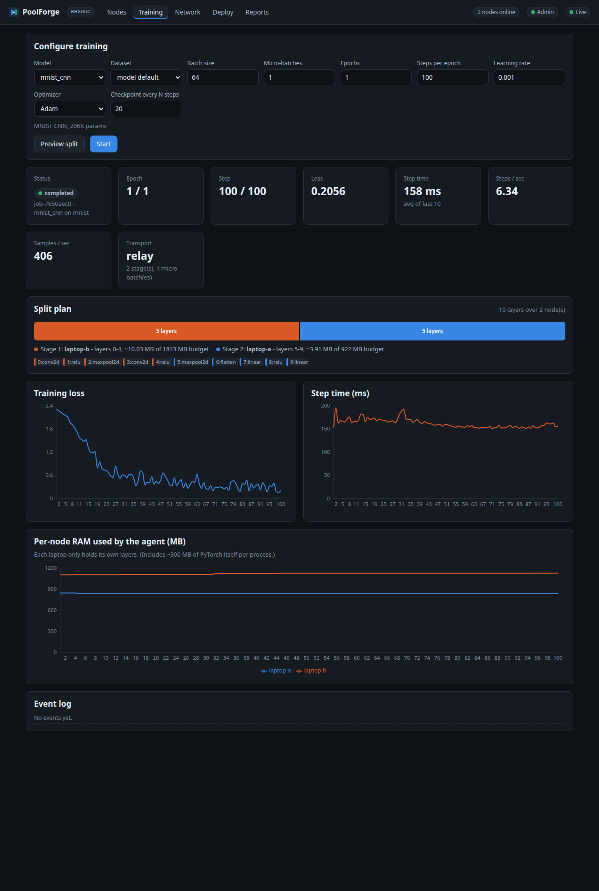
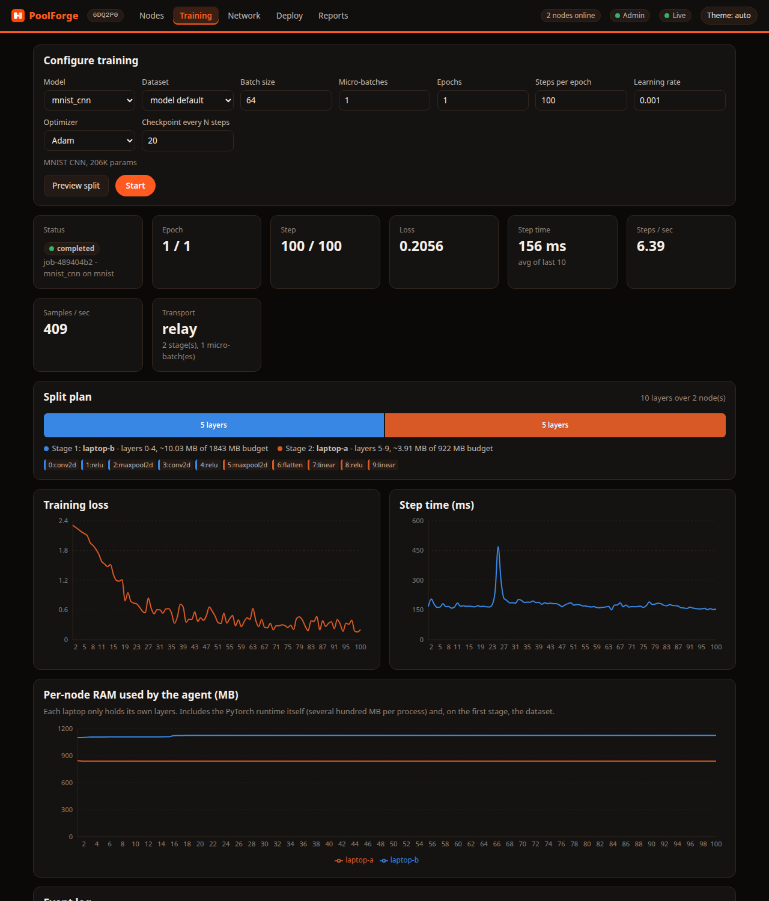
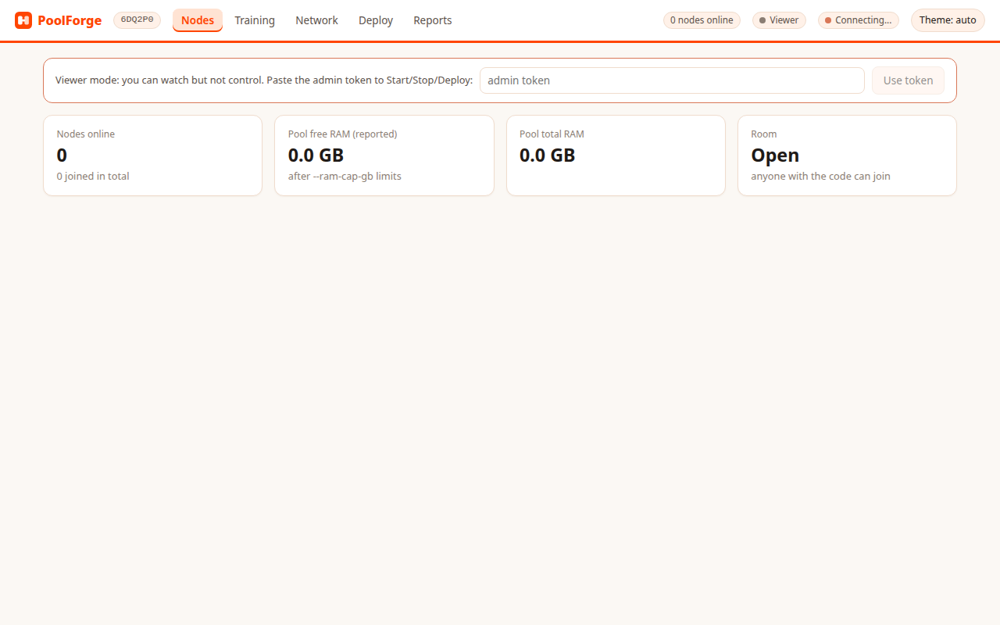
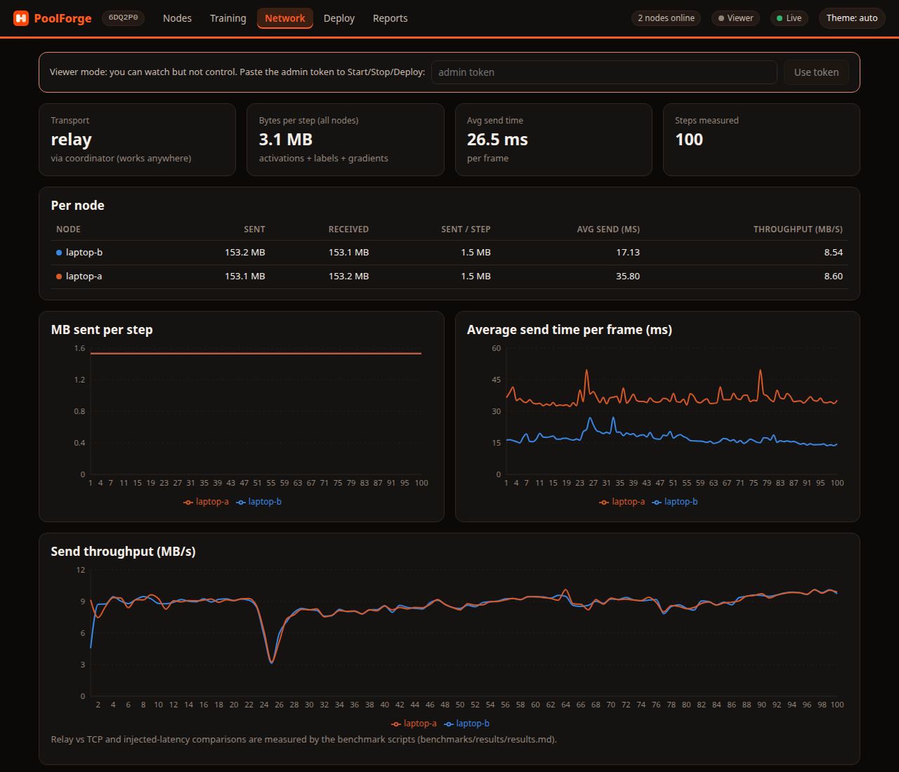
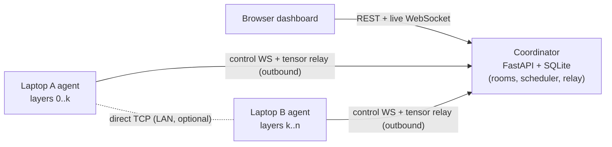

# PoolForge

**Pool laptops' spare RAM and compute to train AI models and host apps together.**
MCA project. Python (PyTorch, FastAPI) + React. Runs on Windows and Linux.

Two or more laptops, anywhere, join one *pool* through a link. A neural network is
split **by layers** across them (pipeline parallelism), so no laptop has to hold the
whole model. A live dashboard starts and stops training, shows loss, speed, RAM and
network traffic, and can deploy small web apps onto pool laptops.

> **Honest summary.** RAM is not literally merged: each laptop stores *part* of the
> model, so together they fit a model none could fit alone (**1.75x larger** in our
> benchmark). But every step must cross the network, so training is **slower** than on
> one laptop (18% on localhost, ~2x with 50 ms latency). See
> [benchmarks/results/results.md](benchmarks/results/results.md).

| Training (light theme) | Training (dark theme) |
|---|---|
|  |  |
| **Nodes** | **Network** |
|  |  |

## Quick start (about 5 minutes)

Needs **Python 3.10+** and Git. Node.js is NOT needed (the dashboard is pre-built).

```bash
git clone <this repo> poolforge && cd poolforge
python -m venv .venv
source .venv/bin/activate          # Windows: .venv\Scripts\activate
pip install -r requirements.txt    # PyTorch etc. (the biggest download)
pip install -e .                   # installs the `poolforge` command
```

Windows: use `py -m venv .venv` and `.venv\Scripts\activate` (PowerShell may need
`Set-ExecutionPolicy -Scope CurrentUser RemoteSigned` once). NVIDIA GPU on Windows: run
`pip install torch --index-url https://download.pytorch.org/whl/cu126` before the
requirements, because the default Windows PyTorch is CPU-only. Linux needs nothing extra.

**Friends joining a pool** don't need this repo or Python: they download the PoolForge
app from the Join page, open it and paste the link. It sets itself up on first run.
See [docs/DEPLOY.md](docs/DEPLOY.md#desktop-app-what-friends-install).

**See it all on one machine (coordinator + 2 simulated laptops):**

```bash
bash scripts/dev_two_agents.sh --train                                   # Linux / macOS / Git Bash
powershell -ExecutionPolicy Bypass -File scripts\dev_two_agents.ps1 -Train  # Windows
```

Open the printed **Dashboard** link. Two nodes appear (capped at 1 GB and 2 GB),
an MNIST CNN starts training across them, and the loss falls live.

**Or step by step:**

1. `python -m coordinator.server`, then open http://localhost:8000 and click **Create Pool**.
2. In two other terminals (or on two laptops on the same Wi-Fi, using the first laptop's IP):
   `poolforge join <CODE> --server http://localhost:8000 --ram-cap-gb 1`
3. In the dashboard: **Training -> Preview split -> Start**.

**Friends on other networks:** deploy the coordinator with one Docker command or on
Render/Railway, then share the join link. See [docs/DEPLOY.md](docs/DEPLOY.md).

```bash
docker build -t poolforge-coordinator . && docker run -p 8000:8000 -v poolforge-data:/app/data poolforge-coordinator
```

## How it works



1. **Join.** `poolforge join CODE` connects *outbound* (no port forwarding) and gets a secret node token.
2. **Plan.** The coordinator estimates each layer's memory
   (`params x 4 B x 4 + activation x batch x 4 B`) and gives each laptop a contiguous
   block of layers proportional to its free RAM, or replies **"pool too small"**.
3. **Train.** Laptop A runs its layers and sends `out.detach()` forward. Laptop B
   receives it, calls `requires_grad_()`, computes the loss, calls `backward()` and
   sends `inp.grad` back. Laptop A calls `out.backward(grad)`. Each laptop updates
   its own weights. The losses equal normal single-process training (tested to 1e-5).
4. **Watch.** Every step reports loss, time, bytes and RAM to the dashboard.
5. **Survive.** If a laptop drops, the job pauses and resumes from the last common
   checkpoint when it returns, or fails cleanly after 30 s.

Tensors travel as `[4-byte length][JSON header][raw bytes]`: **never pickle**.
Details: [ARCHITECTURE](docs/ARCHITECTURE.md) | [PROTOCOL](docs/PROTOCOL.md) | [DECISIONS](docs/DECISIONS.md) | [LIMITATIONS](docs/LIMITATIONS.md) | [VIVA DEMO](docs/DEMO.md)

## Features

| Area | What you get |
|---|---|
| Pooling | N-stage pipeline, auto split by free RAM (or free VRAM on GPU nodes), `--ram-cap-gb` / `--vram-cap-gb`, micro-batching |
| GPU | Each node trains its layers on its own GPU (NVIDIA/AMD via CUDA/ROCm, Apple MPS) automatically; GPU and CPU laptops mix in one pipeline; `--device cpu` opts out |
| Chat & voice | Room chat and a browser voice call (WebRTC, peer to peer) in a side panel on every dashboard tab; optional TURN for strict networks |
| Models | `tiny`, `mnist_mlp`, `mnist_cnn` (real MNIST, offline synthetic fallback), `large_mlp` (width/depth configurable) |
| Transports | Relay through the coordinator (works anywhere) or direct TCP (`--transport tcp`); `--simulate-latency-ms` |
| Dashboard | Home, Join, Nodes, Training, Network, Deploy, Reports (CSV/JSON); orange light/dark theme, mobile friendly |
| Robustness | Auto-reconnect with backoff, checkpoints every K steps, pause/resume/stop, node-drop resume, heartbeat timeout |
| Security | Node + admin tokens (hashed), room lock, rate limits, pydantic validation, no pickle, allow-listed hosting, optional AES-256-GCM (`--encrypt-passphrase`) |
| Hosting | Static site / Flask / allow-listed Docker images on a pool laptop, Cloudflare quick-tunnel URL or IP:port fallback |
| Packaging | Docker image (164 MB, no torch), Render/Railway configs, Nuitka-compiled desktop app (`deploy/build_app.py`) |

## Tests and benchmarks

```bash
make test                      # or: python -m pytest -q   (74 tests, ~45 s)
python -m benchmarks.run_all   # ~3 min -> benchmarks/results/*.csv, *.png, raw_tables.md
```

The key correctness test is `tests/test_split_training.py::test_split_loss_equals_single_process`.

| Benchmark (one PC, 4 threads per "laptop") | Result |
|---|---|
| a. Capacity, 0.3 GB per laptop | 1 laptop: up to 12.5M params; 2-laptop pool: up to 31M |
| b. Model RAM per node | 526 MB single -> 409 / 361 MB pooled |
| c. Speed | 7.08 -> 5.81 steps/s (pool is slower) |
| d. Relay vs TCP | 177 vs 132 ms/step |
| e. Latency 0/20/50/100 ms | 1.0x / 1.45x / 2.09x / 3.18x step time |
| f. Micro-batching | M=2 saves 3.4% at 50 ms latency; M>2 is slower |

## Project layout

```text
agent/        poolforge CLI: worker (connection), trainer (one stage), hosting (apps)
coordinator/  FastAPI server, hub (live state + job lifecycle), scheduler, SQLite
common/       wire protocol, transports, layer specs, model zoo, datasets, pipeline engine, schemas, crypto
dashboard/    React + Vite + Recharts (src/) and the built site (dist/)
benchmarks/   harness + run_all + results/
Dockerfile    optional coordinator image; render.yaml = Render blueprint (native Python, no Docker)
deploy/       railway.md, desktop app build, PyInstaller spec, sample apps
launcher/     the desktop app friends download (first-run setup + join window)
docs/         architecture, protocol, decisions, limitations, demo, deploy, screenshots
scripts/      dev_two_agents.sh / .ps1
tests/        pytest suite (phases 0-8)
```

## Developing the dashboard

```bash
cd dashboard && npm install
npm run dev      # http://localhost:5173, proxies /api and /ws to the coordinator on :8000
npm run build    # writes dashboard/dist (commit it so users don't need Node)
```

## Commands

```text
poolforge join CODE --server URL [--ram-cap-gb N] [--device auto|cpu|cuda|mps] [--vram-cap-gb N]
               [--transport relay|tcp] [--node-id NAME]
               [--advertise-host IP] [--tcp-port P] [--simulate-latency-ms MS]
               [--encrypt-passphrase PASS] [--threads N] [--workdir DIR]
python -m coordinator.server          # env: PORT / POOLFORGE_PORT, POOLFORGE_DB_PATH, ... (.env.example)
```
# POOL_FORGE
