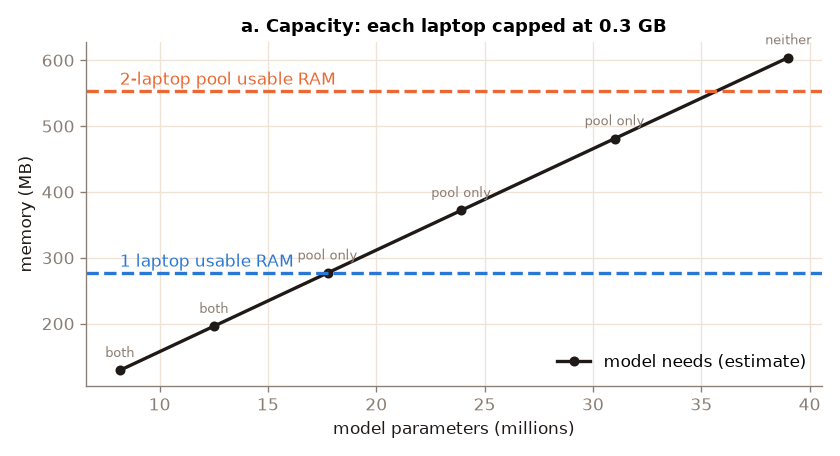
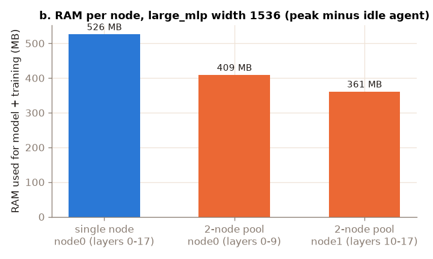
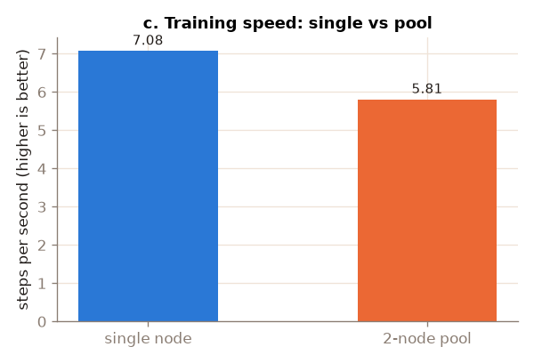
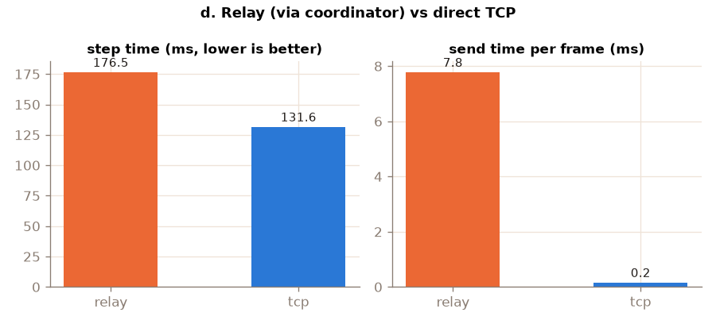
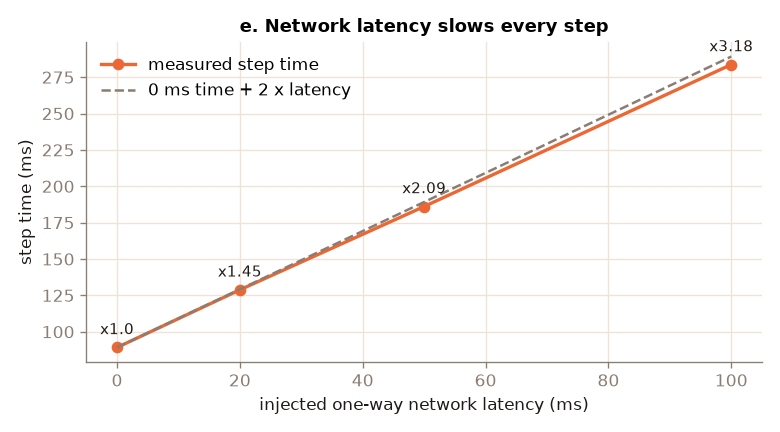
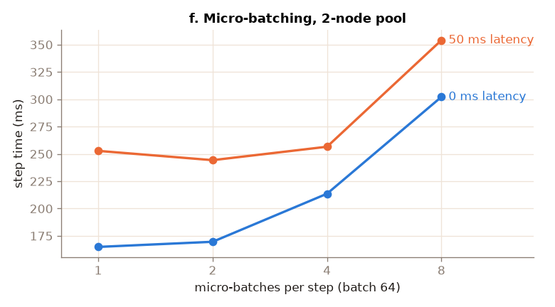

# Raw benchmark tables

Machine: Linux x86_64, 8 CPU threads, 23 GB RAM. 4 threads per simulated laptop. Generated in 157s by `python -m benchmarks.run_all`.

## a. Capacity: one capped laptop vs a 2-laptop pool

| width | params_millions | estimated_mb | cap_per_node_gb | single_node | pool_2_nodes | pool_step_ms | pool_measured_model_ram_mb |
|---|---|---|---|---|---|---|---|
| 1024 | 8.16 | 129 | 0.3 | trained | trained | 102.1 | 583 |
| 1280 | 12.5 | 196 | 0.3 | trained | trained | 144.5 | 667 |
| 1536 | 17.75 | 277 | 0.3 | pool too small | trained | 191.5 | 783 |
| 1792 | 23.92 | 372 | 0.3 | pool too small | trained | 244.6 | 872 |
| 2048 | 31.0 | 481 | 0.3 | pool too small | trained | 296.4 | 1006 |
| 2304 | 39.01 | 604 | 0.3 | pool too small | pool too small |  |  |

## b. RAM per node: single vs pooled

| setup | node | layers | peak_agent_ram_mb | idle_agent_ram_mb | model_ram_mb | avg_step_ms | steps_per_s |
|---|---|---|---|---|---|---|---|
| single node | node0 | 0-17 | 1131 | 605 | 526 | 141.3 | 7.08 |
| 2-node pool | node0 | 0-9 | 1015 | 605 | 409 | 172.2 | 5.81 |
| 2-node pool | node1 | 10-17 | 966 | 605 | 361 | 172.2 | 5.81 |

## c. Steps per second: single vs pooled

| setup | avg_step_ms | steps_per_s |
|---|---|---|
| single node | 141.3 | 7.08 |
| 2-node pool | 172.2 | 5.81 |

## d. Relay vs direct TCP

| transport | avg_step_ms | steps_per_s | bytes_per_step | avg_send_ms_per_frame |
|---|---|---|---|---|
| relay | 176.5 | 5.66 | 787404 | 7.78 |
| tcp | 131.6 | 7.6 | 787410 | 0.16 |

## e. Injected latency

| one_way_latency_ms | avg_step_ms | steps_per_s | slowdown_vs_0ms | expected_extra_ms(2 hops) |
|---|---|---|---|---|
| 0 | 89.2 | 11.22 | 1.0 | 0 |
| 20 | 128.8 | 7.76 | 1.45 | 40 |
| 50 | 186.1 | 5.37 | 2.09 | 100 |
| 100 | 283.7 | 3.52 | 3.18 | 200 |

## f. Micro-batching

| one_way_latency_ms | microbatches | avg_step_ms | steps_per_s |
|---|---|---|---|
| 0 | 1 | 164.9 | 6.06 |
| 0 | 2 | 169.6 | 5.89 |
| 0 | 4 | 213.6 | 4.68 |
| 0 | 8 | 302.2 | 3.31 |
| 50 | 1 | 252.8 | 3.96 |
| 50 | 2 | 244.3 | 4.09 |
| 50 | 4 | 256.6 | 3.9 |
| 50 | 8 | 354.1 | 2.82 |

