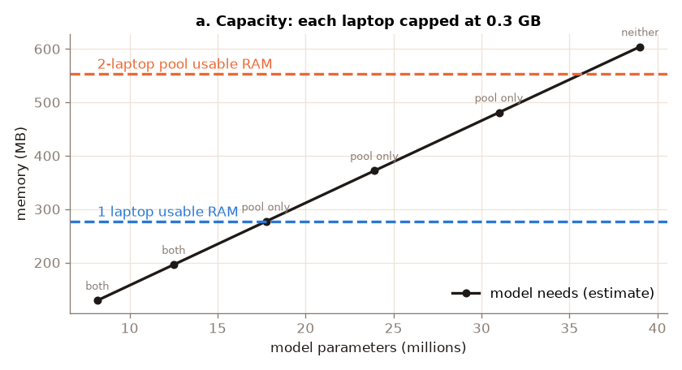
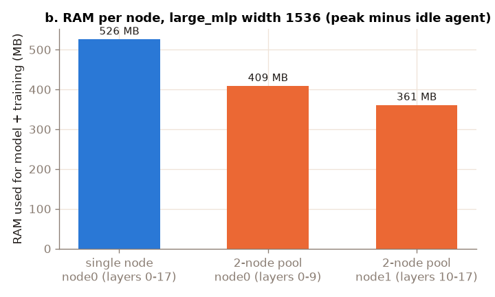
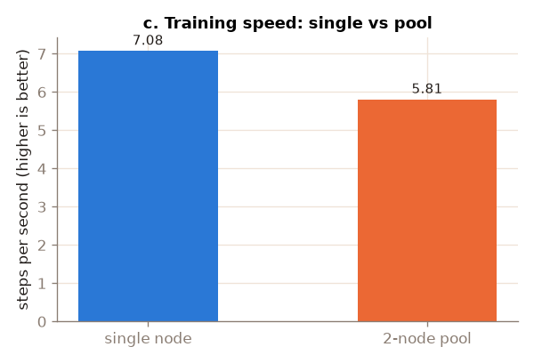
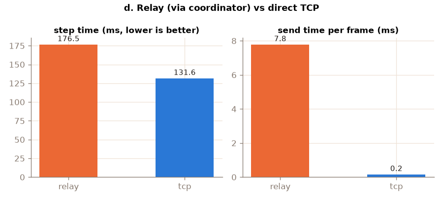
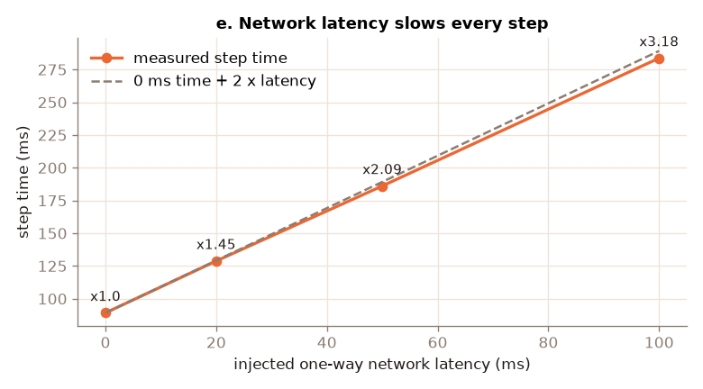
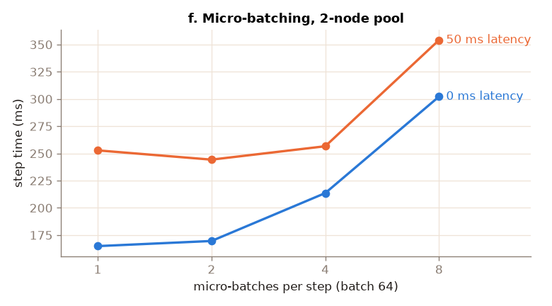

# PoolForge benchmark results

**Setup.** Linux x86_64, 8 CPU threads, 23 GB RAM. The whole system ran on one PC:
the coordinator plus each "laptop" as a separate agent process with 4 PyTorch threads,
driven through the REST API like the dashboard. Synthetic data, batch size 64, Adam.
The model is `large_mlp` (depth 8, width as shown). 25 steps per run; the first 3 are
excluded from timings. Re-run with `python -m benchmarks.run_all` (about 3 minutes).
Exact numbers: the CSV files and `raw_tables.md`.

> **Important:** "network" here is localhost. The relay goes through the coordinator
> on the same machine, so real Wi-Fi or Internet adds latency. Benchmark (e) shows how
> much.

## Headline

| Question | Answer |
|---|---|
| Can the pool train a model one laptop can't? | **Yes.** With 0.3 GB per laptop, one laptop fails ("pool too small") from 17.8M parameters; the 2-laptop pool trains up to 31M (**1.75x larger**). |
| Does each laptop need less RAM? | **Yes.** Model RAM per node fell from 526 MB (single) to 409 / 361 MB. |
| Is it faster? | **No.** The pool is **18% slower** (7.08 vs 5.81 steps/s) even on localhost. |
| What does the network cost? | Each step pays about **2 x the one-way latency**: 50 ms latency means 2.1x slower; 100 ms means 3.2x slower. |
| Relay or TCP? | Direct TCP is **25% faster** (132 vs 177 ms/step); the relay costs ~7.8 ms per frame vs 0.16 ms. |
| Does micro-batching help? | **A little, only with latency.** At 50 ms, 2 micro-batches save 3.4%; more micro-batches are slower. |

## a. Capacity: one capped laptop vs a 2-laptop pool

| width | params (M) | estimated MB | 1 laptop (0.3 GB) | 2 laptops (0.3 GB each) | pool ms/step | measured model RAM, both nodes (MB) |
|---|---|---|---|---|---|---|
| 1024 | 8.2 | 129 | trained | trained | 102 | 583 |
| 1280 | 12.5 | 196 | trained | trained | 145 | 667 |
| 1536 | 17.8 | 277 | **pool too small** | **trained** | 192 | 783 |
| 1792 | 23.9 | 372 | **pool too small** | **trained** | 245 | 872 |
| 2048 | 31.0 | 481 | **pool too small** | **trained** | 296 | 1006 |
| 2304 | 39.0 | 604 | pool too small | pool too small | - | - |

The scheduler refuses up front with a clear "pool too small" message instead of
crashing mid-training. The measured RAM grows with the model at about the predicted
rate (+423 MB measured vs +352 MB estimated from width 1024 to 2048). On top of that,
each process uses a fixed ~225 MB of PyTorch working memory that the spec formula does
not count. So the estimate is good for *comparing* models, but a real 0.3 GB laptop
would need more headroom (see LIMITATIONS.md).

## b. RAM per node: single vs pooled (width 1536)

| setup | node | layers | peak agent RAM | idle agent RAM | model RAM |
|---|---|---|---|---|---|
| single | node0 | 0-17 | 1131 MB | 605 MB | **526 MB** |
| pool | node0 | 0-9 | 1015 MB | 605 MB | **409 MB** |
| pool | node1 | 10-17 | 966 MB | 605 MB | **361 MB** |

Each pooled node needs 22-31% less RAM for the model. It is not 50%, because each
process also pays fixed PyTorch overhead, and the first stage keeps the training batch.
The idle agent itself (Python + PyTorch loaded) is ~605 MB on every node.

## c. Steps per second: single vs pooled

| setup | ms/step | steps/s | samples/s |
|---|---|---|---|
| single node | 141 | 7.08 | 453 |
| 2-node pool (relay) | 172 | 5.81 | 372 |

Pipeline stages run one after another (stage 1 waits for stage 0's activations, then
stage 0 waits for gradients), so adding a laptop does **not** add speed. The ~30 ms
extra is serialization plus two relay hops per step.

## d. Relay vs direct TCP (2 nodes, width 1536)

| transport | ms/step | steps/s | bytes/step | send time per frame |
|---|---|---|---|---|
| relay | 177 | 5.66 | 787 KB | 7.8 ms |
| tcp | 132 | 7.60 | 787 KB | 0.16 ms |

The same bytes are sent either way (activations + labels + gradients, ~787 KB per
step). The relay adds a WebSocket hop through the coordinator. Use `--transport tcp`
when laptops share a LAN or Tailscale; use the relay when they don't.

## e. Injected latency (2 nodes, width 1024)

| one-way latency | ms/step | slowdown | expected extra (2 hops) |
|---|---|---|---|
| 0 ms | 89 | 1.00x | 0 |
| 20 ms | 129 | 1.45x | 40 ms |
| 50 ms | 186 | 2.09x | 100 ms |
| 100 ms | 284 | 3.18x | 200 ms |

Measured step time is almost exactly `base + 2 x latency`: one trip forward for
activations and one trip back for gradients. Across cities (50-100 ms) training runs
**2-3x slower** than on one laptop. This is the main trade-off of pooling over the
Internet.

## f. Micro-batching (2 nodes, width 1536)

| latency | M=1 | M=2 | M=4 | M=8 |
|---|---|---|---|---|
| 0 ms | 165 ms | 170 ms | 214 ms | 302 ms |
| 50 ms | 253 ms | **244 ms** | 257 ms | 354 ms |

Micro-batching lets one laptop work while the other waits, so it can hide a little
latency (-3.4% at 50 ms with M=2). But each extra micro-batch adds frames (per-frame
relay overhead) and makes the matrix multiplications smaller and less efficient on CPU.
On this setup, M > 2 is always slower. It would pay off with more stages, heavier
layers, or GPUs. **Recommendation: M=1 on fast links, M=2 on slow links.**

## Conclusion

PoolForge does what it claims, and the numbers show the honest cost:

- **Capacity: yes.** Two 0.3 GB laptops trained a model 1.75x bigger than one could,
  and each node needs less RAM.
- **Speed: no.** Pooling is slower than one laptop: ~18% slower on a LAN-like link,
  2-3x slower over the Internet.
- Pooling is worth it when the model **doesn't fit otherwise**, not to train faster.
