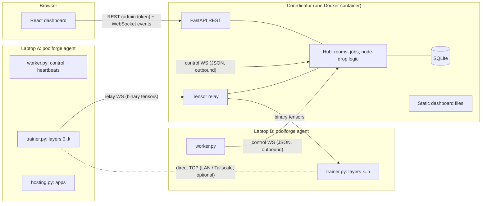
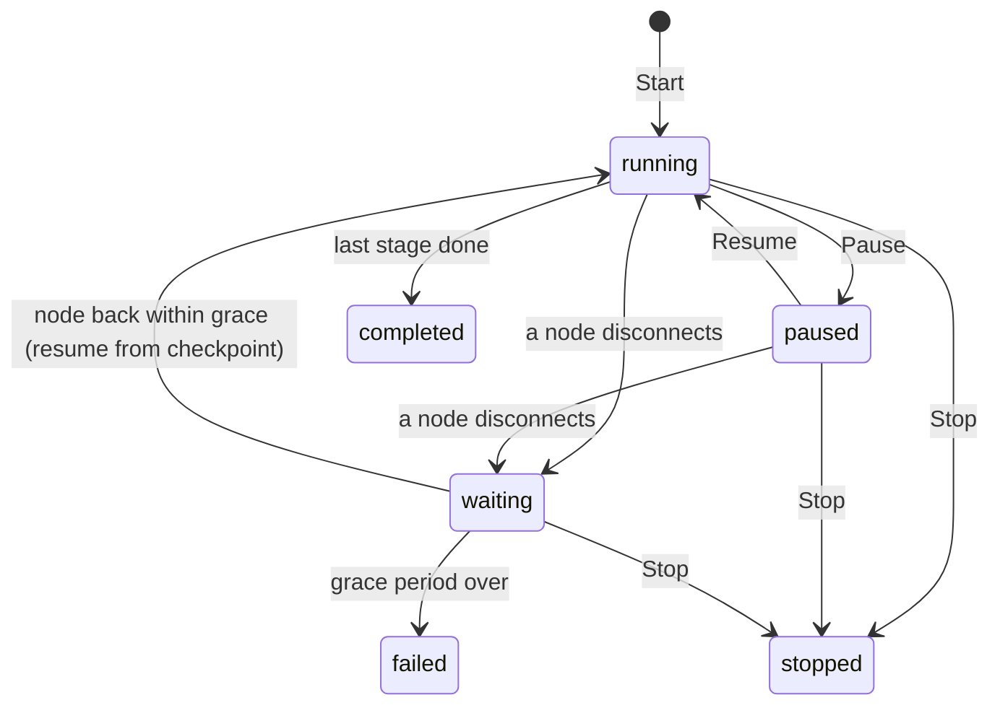

# Architecture

## The idea in one paragraph

A neural network is an ordered list of layers. PoolForge cuts that list into
contiguous blocks and gives each block to a different laptop (**pipeline
parallelism**). Laptop 1 runs layers 0-4 and sends its output (the *activation*)
to laptop 2. Laptop 2 runs layers 5-9, computes the loss and sends the *gradient*
of its input back. Each laptop updates only its own weights. No laptop ever holds
the whole model, which is how several small laptops together train a model that
doesn't fit in any one of them. The cost is that every step now waits for the network.

## Components



| Folder | What it contains |
|---|---|
| `common/` | shared code: `protocol.py` (tensor wire format), `transports.py` (Relay / TCP / Local), `specs.py` (shapes, params, memory, no torch), `models.py` (build layers), `model_zoo.py`, `datasets.py`, `pipeline.py` (training engine), `schemas.py` (pydantic messages), `crypto.py`, `apps.py` (hosting allow-list) |
| `coordinator/` | `server.py` (routes and WebSockets), `hub.py` (live state, job lifecycle), `scheduler.py` (split planner), `db.py` (SQLite) |
| `agent/` | `cli.py` (`poolforge` command), `worker.py` (connection and messages), `trainer.py` (runs one stage), `hosting.py` (Deploy tab) |
| `dashboard/` | React + Vite + Recharts source (`src/`) and the build (`dist/`) served by the coordinator |
| `benchmarks/` | `harness.py` (real processes driven via REST), `run_all.py`, `results/` |
| `Dockerfile`, `render.yaml` (repo root), `deploy/` | coordinator image, Render blueprint, Railway notes, PyInstaller spec, sample apps |

## Control plane vs data plane

- **Control plane**: small JSON messages over a WebSocket (assign, pause, stats,
  metrics). Every message is validated with pydantic.
- **Data plane**: big binary tensor frames. By default they are relayed through the
  coordinator (works behind any NAT). With `--transport tcp` they go directly
  between laptops (faster, but the laptops must be able to reach each other).

Both go through the same `Transport` interface (`send(target, bytes)` /
`recv()`), so the training code is identical either way.

## One training step (2 stages)

```mermaid
sequenceDiagram
  participant S0 as Stage 0 (laptop A, has data)
  participant C as Coordinator relay
  participant S1 as Stage 1 (laptop B, last)
  S0->>S0: out = layers(x)
  S0->>C: activation(step, m) + labels
  C->>S1: forward frames
  S1->>S1: inp.requires_grad_(); loss = CE(layers(inp), y)
  S1->>S1: loss.backward(); optimizer.step()
  S1->>C: gradient = inp.grad
  C->>S0: forward frame
  S0->>S0: out.backward(grad); optimizer.step()
  S1-->>C: step metric (loss, time, bytes) via control WS
```

**Why it is exact.** `out.detach()` cuts the autograd graph at the laptop boundary.
`requires_grad_()` on the received copy starts a new graph. After `backward()`,
`inp.grad` is exactly dLoss/dActivation, so `out.backward(inp.grad)` on the previous
laptop continues backpropagation as if the graph had never been cut.
`tests/test_split_training.py` checks that the losses equal single-process training
(same seed) within 1e-5, for 2, 3 and 4 stages, with and without micro-batches.

**Micro-batching.** The batch is cut into M pieces. Stage 0 can compute piece 2
while stage 1 is still working on piece 1, so part of the waiting is hidden (GPipe
schedule).

## Splitting the model (scheduler)

1. `specs.estimate_memory`: for each layer, `params x 4 bytes x 4` (weights, grads,
   2 Adam states) plus `activation elements x batch x 4 bytes`.
2. Nodes are sorted by reported free RAM (`min(real free, --ram-cap-gb)`), and 90% of
   that is usable.
3. Walking the layers, each node takes layers until it reaches its proportional
   share of the model. Every later node still gets at least one layer.
4. Every stage is checked against its node's budget. If one doesn't fit, a second
   pass fills each node up to its budget. If that also fails: **"pool too small"**.

## Job lifecycle and failures



- Every stage saves `checkpoints/<job>/stage<i>_step<k>.pt` every K steps (keeping
  the last 3) and reports it.
- If a node drops, the coordinator pauses the others and waits. When the node is back,
  it re-sends `assign` to all stages with `resume_step` = the newest checkpoint step
  that **every** stage has, and `attempt + 1`, so frames still in flight from the old
  attempt are ignored.
- A node is "dropped" when its control WebSocket closes, or when it misses heartbeats
  for 10 s (sweeper).
- Agents reconnect by themselves (backoff up to 10 s) and resend queued reports.

## Hosting (Deploy tab)

The admin picks an allow-listed app and a node (or "auto": the node with the most free
RAM). The node starts it as a subprocess (sample apps) or a `docker run` (docker
apps), waits for the port to open, then runs `cloudflared tunnel --url
http://localhost:PORT` and reports the `https://*.trycloudflare.com` URL. Without
cloudflared it reports `http://<LAN IP>:PORT`; without Docker it reports a clear
error.

## Where state lives

| State | Where |
|---|---|
| rooms (admin token hash, locked), node tokens (hashes), jobs, per-step metrics, deployments | SQLite (`data/poolforge.db`) |
| open sockets, latest stats, active job progress, pending relay frames | coordinator memory (`Hub`) |
| model weights and optimizer state | only on the laptop that owns those layers (plus its local checkpoints) |
| training data | generated or downloaded locally by the first stage |
